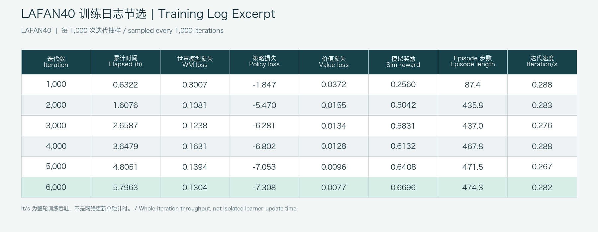

# MPS-Supermimic

面向 Apple Silicon 的可编辑 SuperMimic 实现。物理环境通过 MuJoCo-Warp MPS 后端在 Apple GPU 上批量运行；学习器、损失与梯度、想象轨迹和优化器更新使用 MLX/Metal。本文集中说明项目实现、运行方法、Clip 1 案例、LAFAN40 日志节选及当前待优化项。

### 项目实现

- **学习计算路径：**`supermimic/mlx_train.py` 使用 MLX 完成 world model、policy 和 critic 的网络计算、反向传播、想象轨迹训练及参数更新。批量物理 rollout 由 `supermimic/mlx_mps_env.py` 调用 MPS 环境；仿真状态留在 MLX 数组中跨步传递。Python 主机负责数据 I/O、任务编排、episode 重置和日志。物理步进本身不做反向微分，policy 梯度经学习到的 world model 和想象轨迹传播。
- **硬件路径：**学习和 MPS 仿真使用 Apple Metal，不调用 NVIDIA CUDA，也不要求 NVIDIA GPU。`warp-lang` 仍是 vendored MuJoCo-Warp 的依赖及参考路径。
- **MuJoCo-Warp 基线：**`third_party/mujoco_warp/` vendored 自 `lucidrains/mujoco_warp`，基线提交 `1b65d3b5d5b721eff34a799cdc98a7bd7626a03b`，Apache-2.0。源码和本项目补丁都在仓库内，可直接编辑。
- **新增碰撞路径：**MPS 窄相位增加 capsule-box（opcode 7）及 box-box（opcode 8），分别支持接触点生成；融合 MLX/Metal 内核实现 capsule 凸体面裁剪及边缘回退、box-box 分离轴接触流形。回归测试覆盖这两类碰撞。
- **`implicitfast`：**Metal 求解器接入 MuJoCo `implicitfast` 所需的执行器速度导数和按时间步缩放的隐式对角修正；执行器力饱和时屏蔽不平滑导数，该路径关闭 cooperative solver，并有独立测试。
- **G1 适配：**`supermimic/mps_g1.py` 校验 29 个执行器。默认 G1 场景使用 4 ms 物理步长，每个 20 ms 控制动作运行 5 个子步；碰撞使用手工设计的 sphere/capsule/box 代理几何和 49 组显式接触对，不以渲染网格作为稠密碰撞网格。检查点记录物理场景，查看器会校验场景是否匹配。
- **学习目标：**world model 以 8 步递归窗口训练；policy 使用 32 步可微想象轨迹；critic 使用参考 gamma/lambda 的价值目标。policy 梯度通过 MLX 学得的 world model 传播，而不是对 MPS 物理积分器反向微分。当前 MLX 网络使用稳定 ELU 实现；历史单 clip 训练中发现的 ELU 非有限梯度路径已有修复和回归覆盖。

### 安装与运行

要求 macOS 14 或更新版本、Apple Silicon、Python 3.12 和 `uv`：

```bash
brew install uv
./scripts/setup_macos.sh
```

动作 CSV 不随项目分发。按上游 CC BY-NC-ND 4.0 条款获取数据后，下载器会校验 40 个 LAFAN1 G1 CSV：

```bash
uv run python tools/download_lafan1_g1.py
```

本地快速训练使用 128 个并行环境：

```bash
./scripts/train_mps.sh --profile local
```

查看检查点和参考动作：

```bash
./scripts/view_checkpoint.sh logs/mlx_mps_local/latest --clip dance1_subject1.csv
```

命令行参数可通过 `uv run python -m supermimic.mlx_train --help` 查看。默认 `local` 训练为较长运行；所有生成的 CSV 数据、日志、检查点和虚拟环境均不应加入发布包。

### Clip 1 案例

下图按录屏时间每 5 秒取一帧，共 36 帧，按从左到右、从上到下排列。裁剪移除了 viewer 左右控制面板，只保留中间仿真视口；白色 G1 为策略输出，青色半透明 G1 为参考动作。

[观看裁剪压缩后的完整录屏](examples/clip1_cropped.mp4)：H.264、960×928、30 fps、3:05；


这段演示对应 LAFAN40 训练的 **iteration 6,000 检查点**。该训练使用 40 个 LAFAN1 G1 clip、441,140 个 50 Hz 动作帧；下表是运行参数摘要，数值来自该检查点配置；统一内存为本次运行记录值。

| 项目                        | LAFAN40 运行配置                                                                                                                                                            |
| ------------------------- | ----------------------------------------------------------------------------------------------------------------------------------------------------------------------- |
| Profile / 检查点             | `origin` profile；1,024 个并行环境；目标 6,000 次，演示检查点 6,000 次                                                                                                                   |
| Replay / world model      | replay 500 steps；窗口 8；每轮 10 个 batch；batch 512；网络宽度 2,048                                                                                                                |
| Policy / imagined rollout | policy batch 1,024；horizon 32；history 10；goal frames 10                                                                                                                 |
| 优化器与训练控制                  | learning rate 2e-4；gamma 0.99；lambda 0.95；UTD 0.4；action noise 0.1；critic 5 epochs × 4 minibatches；warmup 64；world-model-only 500 iterations；学习率衰减长度 250,000 iterations |
| 精度与调试                     | MLP matmul `float16`；actor rollout activation checkpointing；`debug_nonfinite_grad` 开启；seed 0                                                                            |
| 仿真                        | `implicitfast`；4 ms × 5 substeps = 20 ms/action；49 组显式接触对；contact row cap 230；episode 上限 500 steps                                                                      |
| 6,000 次检查点耗时              | 20,866.84 秒，约 **5 小时 47 分 47 秒**                                                                                                                                        |
| 统一内存占用                    | **18 GB**                                                                                                                                                               |

下图从本次 LAFAN40 训练的 `train_log.csv` 抽取 1,000 至 6,000 次迭代的记录，显示累计训练时间、world model/policy/value loss、模拟奖励、episode 长度和整体迭代吞吐。数值按图中精度四舍五入；完整原始训练日志未随项目分发。



### 当前待优化项与结果边界

- **网络参数更新速度仍待优化。**图中 `it/s` 是完整训练迭代的整体吞吐，不等同于网络更新本身的耗时；需要用分阶段计时进一步定位网络计算、物理 rollout 与数据编排的耗时占比。
- **检查点仅用于推理。**当前保存内容不含 optimizer、replay、仿真状态、RNG 和 UTD 累积状态，因此不能从该文件精确恢复训练。
- **统一内存随参数变化。**18 GB 对应本次 40-clip、1,024 环境运行记录，不是所有 Apple Silicon 设备的固定要求。
- **仿真几何是代理模型。**稳定性和计算量受显式接触对、碰撞代理几何及 contact-row 上限影响；改变它们需要重新验证。

### 测试与基准

```bash
uv run pytest -n 8
uv run pytest -n 8 \
  third_party/mujoco_warp/mujoco_warp/mps/collision_test.py \
  third_party/mujoco_warp/mujoco_warp/mps/implicitfast_test.py
```

回归覆盖包括 capsule-box / box-box 碰撞、`implicitfast` 求解和 G1 场景集成。此前项目测试记录为 15 passed；吞吐结果依赖 Apple 芯片、macOS/Metal 版本和训练参数，不应作为跨机器固定指标。

### 许可与来源

项目自有代码使用根目录 MIT 许可。vendored MuJoCo-Warp fork 使用 Apache-2.0；随附 Unitree G1 模型及网格资产使用 BSD-3-Clause；LAFAN1 CSV 使用上游 CC BY-NC-ND 4.0，未随项目分发。分组件声明见 [THIRD_PARTY_NOTICES.md](THIRD_PARTY_NOTICES.md)，fork 来源与基线提交见 [`third_party/mujoco_warp/UPSTREAM.md`](third_party/mujoco_warp/UPSTREAM.md)。SuperMimic 方法来源：[论文](https://arxiv.org/abs/2610.28480)；本仓库是独立实现，不代表论文作者或官方代码。

## English

An editable SuperMimic implementation for Apple Silicon. Batched physics runs through the MuJoCo-Warp MPS backend on the Apple GPU; learner networks, losses and gradients, imagined trajectories, and optimizer updates use MLX/Metal. This document covers the implementation, setup, Clip 1 case, a LAFAN40 log excerpt, and current limitations.

### Project implementation

- **Learning compute path:** `supermimic/mlx_train.py` uses MLX for world-model, policy, and critic computation, backpropagation, imagined-trajectory training, and parameter updates. Batched physics rollouts run through the MPS environment in `supermimic/mlx_mps_env.py`; simulation state remains in MLX arrays across steps. The Python host handles data I/O, orchestration, episode resets, and logging. Physics stepping itself is not differentiated through; policy gradients flow through the learned world model and imagined trajectories.
- **Hardware path:** Learning and MPS simulation use Apple Metal, not NVIDIA CUDA, and do not require an NVIDIA GPU. `warp-lang` remains a dependency and reference path for the vendored MuJoCo-Warp package.
- **MuJoCo-Warp baseline:** `third_party/mujoco_warp/` vendors `lucidrains/mujoco_warp` at base commit `1b65d3b5d5b721eff34a799cdc98a7bd7626a03b` under Apache-2.0. Both the fork source and this project's patches are included and editable.
- **Added collision paths:** The MPS narrowphase adds capsule-box (opcode 7) and box-box (opcode 8) contact generation. Fused MLX/Metal kernels implement capsule-versus-convex face clipping with an edge fallback, and a separating-axis contact manifold for box-box. Regression tests cover both paths.
- **`implicitfast`:** The Metal solver implements the actuator-velocity derivative and timestep-scaled implicit diagonal correction required by MuJoCo `implicitfast`. The nonsmooth derivative is suppressed when actuator force saturates; the cooperative solver is disabled for this path, which has dedicated tests.
- **G1 adapter:** `supermimic/mps_g1.py` validates the 29-actuator contract. The default G1 scene uses a 4 ms physics step and five substeps per 20 ms control action. Collisions use hand-authored sphere/capsule/box proxy geometry and 49 explicit contact pairs rather than dense collision meshes derived from render meshes. Checkpoints record the physics scene, and the viewer checks scene compatibility.
- **Learning objective:** The world model trains with an 8-step recursive window; the policy uses a 32-step differentiable imagined rollout; the critic uses value targets configured by gamma and lambda. Policy gradients pass through the MLX-learned world model rather than through the MPS physics integrator. The current MLX networks use a stable ELU implementation with regression coverage for a non-finite-gradient path found in earlier single-clip training.

### Install and run

Requirements: macOS 14 or later, Apple Silicon, Python 3.12, and `uv`.

```bash
brew install uv
./scripts/setup_macos.sh
```

Motion CSVs are not distributed with the project. Obtain them under the upstream CC BY-NC-ND 4.0 terms; the downloader verifies 40 LAFAN1 G1 CSV files:

```bash
uv run python tools/download_lafan1_g1.py
```

The local training profile uses 128 parallel environments:

```bash
./scripts/train_mps.sh --profile local
```

View a checkpoint with its reference motion:

```bash
./scripts/view_checkpoint.sh logs/mlx_mps_local/latest --clip dance1_subject1.csv
```

Run `uv run python -m supermimic.mlx_train --help` to list command-line options. The default `local` training run is long; generated CSV data, logs, checkpoints, and virtual environments should not be added to a release package.

### Clip 1 case

The contact sheet samples one frame every five seconds, for 36 frames total, ordered left to right and top to bottom. The crop removes the viewer's side panels and retains the central simulation viewport; the solid white G1 is the policy output, and the translucent cyan G1 is the reference motion.

[Watch the cropped recording](examples/clip1_cropped.mp4): H.264, 960×928, 30 fps, 3:05.

The demo corresponds to the **iteration-6,000 checkpoint** from the LAFAN40 training run. Training used 40 LAFAN1 G1 clips (441,140 frames at 50 Hz). The table summarizes the configuration recorded for this checkpoint; unified memory is the value recorded for this run.

| Item | LAFAN40 run configuration |
|---|---|
| Profile / checkpoint | `origin` profile; 1,024 parallel environments; 6,000-iteration target and displayed checkpoint |
| Replay / world model | 500 replay steps; window 8; 10 batches per iteration; batch size 512; width 2,048 |
| Policy / imagined rollout | policy batch 1,024; horizon 32; history 10; goal frames 10 |
| Optimizer and training control | learning rate 2e-4; gamma 0.99; lambda 0.95; UTD 0.4; action noise 0.1; critic 5 epochs × 4 minibatches; 64 warmup steps; 500 world-model-only iterations; learning-rate decay over 250,000 iterations |
| Precision and debugging | `float16` MLP matmul; actor-rollout activation checkpointing; `debug_nonfinite_grad` enabled; seed 0 |
| Simulation | `implicitfast`; 4 ms × 5 substeps = 20 ms/action; 49 explicit contact pairs; contact-row cap 230; 500-step episode limit |
| Iteration-6,000 checkpoint runtime | 20,866.84 seconds, about **5 h 47 min 47 s** |
| Unified memory | **18 GB** |

The image below samples iterations 1,000 through 6,000 from the LAFAN40 run's `train_log.csv`. It shows cumulative runtime, world-model/policy/value losses, simulated reward, episode length, and overall iteration throughput. Values are rounded as shown; the full raw training log is not included in the project.


### Current limitations and open work

- **Neural-network parameter update speed still needs optimization.** The logged `it/s` is end-to-end training-iteration throughput, not a direct measurement of network-update time. Phase-level timing is needed to separate learner computation, physics rollout, and orchestration costs.
- **Checkpoints are inference-only.** They do not store optimizer, replay, simulator, RNG, or UTD accumulator state, so exact training resume is not supported.
- **Memory use depends on the run configuration.** The 18 GB figure applies to this 40-clip, 1,024-environment run and is not a fixed requirement across Apple Silicon devices.
- **Physics uses proxy geometry.** Stability and workload depend on the explicit contact pairs, collision proxies, and contact-row cap; changes to them require revalidation.

### Tests and benchmarks

```bash
uv run pytest -n 8
uv run pytest -n 8 \
  third_party/mujoco_warp/mujoco_warp/mps/collision_test.py \
  third_party/mujoco_warp/mujoco_warp/mps/implicitfast_test.py
```

Regression coverage includes capsule-box and box-box collisions, `implicitfast`, and G1 scene integration. A previous project test run reported 15 passed. Throughput depends on the Apple chip, macOS/Metal version, and training parameters, so it should not be treated as a fixed cross-machine benchmark.

### Licenses and attribution

Project code is licensed under the root MIT license. The vendored MuJoCo-Warp fork is Apache-2.0; the included Unitree G1 model and mesh assets are BSD-3-Clause; LAFAN1 CSVs are not distributed and remain subject to the upstream CC BY-NC-ND 4.0 terms. See [THIRD_PARTY_NOTICES.md](THIRD_PARTY_NOTICES.md) for component-level notices and [`third_party/mujoco_warp/UPSTREAM.md`](third_party/mujoco_warp/UPSTREAM.md) for the fork source and base commit. The [SuperMimic paper](https://arxiv.org/abs/2610.28480) is the method reference; this repository is an independent implementation, not the authors' official code.
